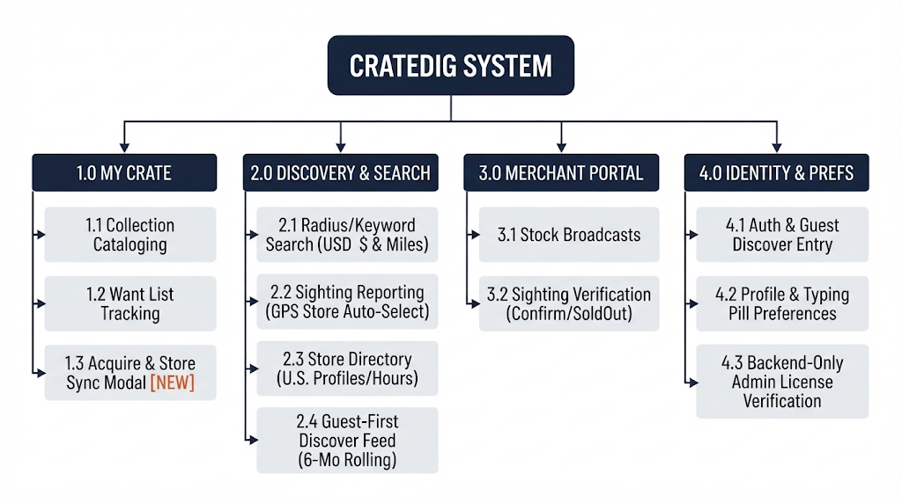
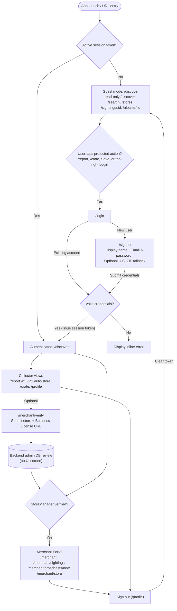

# CrateDig — Product Requirements Document

_Source: Specification #3 — Final System Specification (Level 3). This supersedes Specification #1; see [Appendix B](#appendix-b--changes-from-specification-1) for what changed._

> System Name: CrateDig · Document Level: Level 3 Final Specification (Strategy, Scope, Structure & Skeleton) · Sponsor: Tyler Winslow · Date: November 2026

## Executive Summary of Level 3 Final Updates (Interview #3 & Prototype #2 Review)

This final Level 3 Specification integrates all client decisions from Client Interview #3 and the review of Prototype #2, establishing the complete blueprint for the Builder's final prototype:

- Guest-First Onboarding Flow: Unauthenticated visitors now enter directly into the /discover feed upon launching the app (bypassing login walls) to maximize engagement, with account creation prompted only when logging sightings, saving records, or claiming a store.
- GPS-Assisted One-Tap Store Selection: On the Report a Sighting screen (/report), when GPS permission is granted, the system automatically pre-selects the nearest record store while retaining manual dropdown override.
- Closed-Loop Acquisition Store Prompt: Tapping "Mark as acquired" on a Want List item (/crate/items/:id) triggers a quick selection modal asking which local store the collector purchased the record from (or "Acquired elsewhere") so the corresponding local sighting automatically updates to Status = "SoldOut".
- U.S. Regional Standardization: Standardized all currency to U.S. Dollars ($), default distance units to Miles (mi), and sample seed data to a generic U.S. metro area (replacing Vienna addresses and Euro € pricing).
- Approved Visual System & Lightweight Media: Locked in the dark navy theme with burnt orange accents, typing pills for genre/tag entry, two-letter colored album initial badges (with optional web image URLs), web link inputs for shipment photos/licenses, persistent 5-tab bottom navigation, top-right profile/merchant avatar menu, and backend-only admin license verification.

## 1. Strategy Layer (Final Updates)

### 1.1 Project Summary

CrateDig is a lightweight, location-aware web and mobile discovery platform connecting vinyl record collectors with independent local record stores across the United States. Operating as a "GasBuddy for vinyl records," CrateDig enables collectors to locate specific albums in physical shop bins via crowdsourced community sightings and merchant-posted stock broadcasts before traveling across town.

Level 3 Strategic Refinement: Following Interview #3, CrateDig standardizes on U.S. localization (U.S. Dollars $, miles, and U.S. store locations) and prioritizes frictionless, guest-first discovery. To keep the application lightweight and practical for mom-and-pop shops, CrateDig avoids complex POS integrations, camera/file-hosting infrastructure, and public admin panels—relying instead on standardized external catalog metadata (Discogs/MusicBrainz), two-letter initial badges, web image URLs, and a dimly-lit-shop-friendly dark navy and burnt orange interface.

### 1.2 User Constituencies

| User Constituency | Profile & Access Level | Primary Goals & Needs | Constraints & Pain Points |
|---|---|---|---|
| Guest Browser (Unauthenticated Visitor — Updated) | Casual shopper or first-time visitor; zero-login read access starting directly on /discover. | Browse local sighting feeds, search records by radius/genre, and inspect store hours/addresses without creating an account first. | Abandons apps that force immediate registration before demonstrating local inventory value. |
| Experienced Collector (Persona: Maria Reed) | 35 years old; IT Support Specialist; 10+ years collecting; registered Collector role. | Find specific pressings locally in USD ($); log sightings rapidly in-store via GPS auto-select; sync Want List acquisitions with store stock status. | Wasting trips to out-of-stock shops; high online shipping fees; repetitive manual form entry while standing in aisles. |
| Emerging Collector (Persona: Elena Martinez) | 21 years old; College Student; mobile-first user; registered Collector role. | Discover nearby independent record shops; maintain a digital Collection to prevent duplicate purchases; follow local store broadcasts. | Buying duplicate records by mistake; unfamiliarity with local independent shops and specialty genres. |
| Independent Store Manager (Verified Merchant Partner) | 30–60 years old; shop owner/clerk; verified via Business License URL; StoreManager role. | Post daily arrival summaries; confirm accurate shelf sightings; mark sold items as SoldOut; maintain accurate store hours and payment info. | Limited time behind the retail counter; no budget or technical desire for complex POS synchronization. |
| System Administrator (Backend Reviewer — Updated) | Internal platform operator; manages verification strictly via backend database console. | Review submitted Business License URLs and toggle store verification_status to Verified without cluttering the user-facing app. | Keeping frontend prototype clean and focused solely on collectors and store managers. |

### 1.3 Usage Contexts & Operational Assumptions

- Dimly Lit In-Store Visual Ergonomics (FINALIZED): Collectors browse CrateDig on smartphones while digging through physical crates in dimly lit shops. The dark navy canvas (#0F172A) with high-contrast burnt orange buttons (#F97316) reduces screen glare while preserving legibility.
- GPS Auto-Store Detection & ZIP Fallback (FINALIZED): When GPS is enabled, the system calculates distances in miles (mi) and automatically pre-selects the nearest shop during sighting reports. If GPS is denied, users enter a U.S. 5-digit ZIP code fallback.
- Lightweight Media & Metadata Strategy (FINALIZED): To keep bandwidth low in brick-and-mortar shops, records default to colored two-letter initial badges unless an external image URL is referenced, and merchant uploads accept standard web links (https://...).
- U.S. Localization Standard (FINALIZED): All prices display in U.S. Dollars ($), distances default to miles (mi), and seed data represents a U.S. metro area.

## 2. Scope Layer (Finalized)

### 2.1 Revised Feature Chart

The structural Feature Chart below illustrates CrateDig's four core functional domains and eleven sub-modules, incorporating all Level 3 prototype refinements 

| Functional Domain | Sub-Feature Module | Finalized Level 3 Scope & Behavior |
|---|---|---|
| 1.0 My Crate (Collection & Want List) | 1.1 Collection Cataloging | Catalog owned vinyl using standardized metadata, USD ($) price paid, condition grade, and special pressing attributes. |
| 1.0 My Crate (Collection & Want List) | 1.2 Want List Tracking | Maintain a searchable digital wishlist filtered by title, artist, or genre while digging in local stores. |
| 1.0 My Crate (Collection & Want List) | 1.3 Acquire & Store Sync Modal (Updated) | Tapping "Mark as acquired" opens a prompt asking which local store the record was purchased from (or "Acquired elsewhere"), moving it to Collection and marking that store's sighting as SoldOut. |
| 2.0 Discovery & Search Engine | 2.1 Radius & Keyword Search (Updated) | Filter active sightings by keyword, genre dropdown, and radius pills (5 mi, 10 mi, 25 mi) with prices displayed in USD ($). |
| 2.0 Discovery & Search Engine | 2.2 Sighting Reporting (Updated) | API catalog lookup (Discogs/MusicBrainz) with automatic GPS nearest-store pre-selection, condition grade, USD price, and special attributes. |
| 2.0 Discovery & Search Engine | 2.3 Store Directory (Updated) | Distance-sorted U.S. store directory (in miles) showing verified badges, hours, accepted payments, specialty tags, and active sightings/broadcasts. |
| 2.0 Discovery & Search Engine | 2.4 Guest-First Discover Feed (Updated) | Default landing screen (/discover) for both guests and signed-in users displaying a 6-month rolling feed of local sightings and store broadcasts. |
| 3.0 Merchant Partner Portal | 3.1 Stock Arrival Broadcasts | Verified managers publish daily wholesale arrival summaries (up to 500 chars), optional web photo URLs, and up to 10 featured records. |
| 3.0 Merchant Partner Portal | 3.2 Sighting Verification | Managers review community sightings at their shop to Confirm shelf availability, flag inaccuracies, or Mark sold (retaining database history). |
| 4.0 Identity, Preferences & Admin | 4.1 Auth & Guest Access (Updated) | Immediate guest access to Discover, Search, and Stores; email/password login and signup with optional U.S. ZIP fallback for write actions. |
| 4.0 Identity, Preferences & Admin | 4.2 Profile & Typing Pill Preferences | Manage display name, U.S. ZIP fallback, default radius (miles), broadcast push toggle, favorite stores, and typing-pill genre tags. |
| 4.0 Identity, Preferences & Admin | 4.3 Backend Admin Verification (Updated) | Store manager business license URLs are reviewed and approved strictly via backend database administration (no public Admin UI screen). |

### 2.2 Final Set of User Stories

All 10 finalized user stories follow the canonical Role + Goal + Reason structure and map directly to the Level 3 Feature Chart:

| ID | Feature Mapping | User Story (Role, Goal, Reason) |
|---|---|---|
| US-01 | 2.4 Guest-First Discover Feed & 4.1 Auth | As a guest visitor, I want to land directly on the local Discover feed without creating an account first so that I can immediately browse nearby record sightings and store broadcasts before deciding to register. |
| US-02 | 1.1 Collection Cataloging | As a vinyl collector, I want to catalog my owned records with standardized metadata, condition grades, and USD prices paid so that I can check my holdings in-store and avoid buying duplicates. |
| US-03 | 1.2 Want List Tracking | As a vinyl collector, I want to maintain a searchable digital Want List with preferred pressing attributes so that I have an organized target list while digging through store bins. |
| US-04 | 1.3 Acquire & Store Sync Modal | As a vinyl collector, I want to select which local store I bought an album from when marking a Want List item as acquired so that the record moves to my Collection and closes out that shop's active sighting as Sold Out. |
| US-05 | 2.1 Radius & Keyword Search | As a vinyl collector, I want to search active sightings by artist, album, genre, and mile radius (using GPS or a U.S. ZIP fallback) so that I can confirm local availability and USD pricing before driving across town. |
| US-06 | 2.2 Sighting Reporting | As a vinyl collector, I want the sighting form to auto-populate album metadata via API lookup and auto-select my nearest store via GPS so that I can log a record sighting in seconds while standing in the aisle. |
| US-07 | 2.3 Store Directory | As an emerging collector, I want to browse a distance-sorted directory of U.S. independent record stores showing hours, payment methods, and specialty tags so that I can discover reputable local shops nearby. |
| US-08 | 3.1 Stock Arrival Broadcasts | As a verified store manager, I want to publish daily wholesale shipment summaries with optional photo links and featured records so that I can attract local collectors to my shop without itemizing every LP. |
| US-09 | 3.2 Sighting Verification | As a verified store manager, I want to confirm accurate community sightings or mark sold records as Sold Out so that shoppers see trustworthy shelf status while historical sighting data stays preserved. |
| US-10 | 4.2 Profile & Preferences | As a registered collector, I want to save my default U.S. ZIP code, search radius in miles, favorite stores, and typing-pill genre tags so that my discovery feed and broadcast alerts stay tailored to my tastes. |

## 3. Structure Layer (Updated Data Model)

### 3.1 Domain Model Narrative & Level 3 Updates

The CrateDig relational schema maintains six core entities (User, Store, MasterRecord, Sighting, CrateItem, and MerchantBroadcast). Based on Interview #3, the following data model updates and business rules are enforced:

- U.S. Currency & Geolocation Standardization (UPDATED): All monetary attributes (Sighting.price, CrateItem.purchase_price) store values in USD ($). Store locations (Store.street_address, Store.zip_code, Store.latitude, Store.longitude) and user fallbacks (User.default_zip) follow U.S. postal formats, with distances computed in miles.
- Want List Acquisition-to-Sighting Linkage (UPDATED): When a user selects a store in the "Mark as acquired" modal on a CrateItem, CrateItem.purchased_store_id is populated and any matching Active Sighting at that store for that record_id automatically updates to status = 'SoldOut'.
- Lightweight Initial Badges & Optional Cover URLs (UPDATED): MasterRecord.cover_art_url is nullable; when null, the UI deterministically renders a two-letter colored badge from artist_name and album_title.
- Backend-Only Admin Approval (UPDATED): Store.verification_status (Pending, Verified, Rejected) is updated directly via backend admin database access upon reviewing Store.license_doc_url.
- Preserved Cardinalities & 6-Month Feed Lifecycle: User to Store (1:0..1), User to Sighting (1:N), Store to Sighting (1:N), MasterRecord to Sighting (1:N), User to CrateItem (1:N), MasterRecord to CrateItem (1:N), and Store to MerchantBroadcast (1:N). Active sightings auto-archive after 180 days (archive_date).

### 3.2 Updated Data Schema Document

| Entity | Attribute Name | Key | Data Type | Constraint / Level 3 Specification |
|---|---|---|---|---|
| User | user_id | PK | UUID | Unique User Identifier |
| User | display_name | - | String | Collector or Manager Display Name |
| User | email | - | String | Unique, Required Login Email |
| User | user_role | - | Enum | Collector \| StoreManager \| Admin |
| User | default_zip | - | String | 5-digit U.S. ZIP fallback when GPS is denied |
| User | default_radius_miles | - | Integer | Default 10 (5 \| 10 \| 25 miles standardized) |
| User | genre_preferences | - | String[] | Saved via typing-pill tags |
| Store | store_id | PK | UUID | Unique Store Identifier |
| Store | manager_user_id | FK → User | UUID | Verified Store Manager Account |
| Store | business_name | - | String | Independent Record Shop Name |
| Store | street_address / zip | - | String | Standardized U.S. Street Address & ZIP |
| Store | geo_lat / geo_lng | - | Decimal | Used for GPS nearest-store auto-select on /report |
| Store | operating_hours | - | JSON | Mon–Sun open/close times |
| Store | payment_methods / tags | - | String[] | Cash, Card, Apple Pay; Genre Specialty Tags |
| Store | license_doc_url | - | String | External URL to Business License |
| Store | verification_status | - | Enum | Pending \| Verified \| Rejected (Backend-only review) |
| MasterRecord | record_id | PK | UUID | Canonical Album Identifier |
| MasterRecord | api_source_id | - | String | Discogs / MusicBrainz Reference ID |
| MasterRecord | artist_name / album_title | - | String | Artist/Composer & Album Release Title |
| MasterRecord | song_title / record_label | - | String | Key Track & Publishing Record Company |
| MasterRecord | release_year / genre | - | Int / Str | Publication Year & Primary Genre |
| MasterRecord | cover_art_url | - | String | Nullable; defaults to 2-letter colored badge |
| Sighting | sighting_id | PK | UUID | Unique Sighting Observation ID |
| Sighting | record_id / store_id / user_id | FKs | UUID | Links MasterRecord, Store, and Reporter User |
| Sighting | price_usd | - | Decimal | Standardized in U.S. Dollars ($ USD) |
| Sighting | condition_grade | - | Enum | Mint \| NearMint \| VG+ \| VG \| Fair |
| Sighting | special_attributes | - | String | Colored vinyl, 180g, first pressing, remaster |
| Sighting | store_verified | - | Boolean | True when confirmed by Store Manager |
| Sighting | status | - | Enum | Active \| SoldOut \| Flagged \| Archived |
| Sighting | sighting_timestamp / archive_date | - | Timestamp | Auto-archives 180 days (6 months) post-report |
| CrateItem | crate_item_id | PK | UUID | Personal Collection / Want List Item ID |
| CrateItem | user_id / record_id | FKs | UUID | Links Owner User and MasterRecord |
| CrateItem | list_type | - | Enum | Collection \| WantList |
| CrateItem | purchased_store_id | FK → Store | UUID | Selected in "Mark as acquired" store modal; closes matching Sighting |
| CrateItem | purchase_price_usd | - | Decimal | Price paid in U.S. Dollars ($ USD) |
| CrateItem | acquired_at / user_notes | - | TS / Str | Acquisition date & personal pressing notes |
| MerchantBroadcast | broadcast_id | PK | UUID | Unique Broadcast Announcement ID |
| MerchantBroadcast | store_id | FK → Store | UUID | Publishing Verified Store |
| MerchantBroadcast | arrival_summary | - | Text | Up to 500-char daily shipment summary |
| MerchantBroadcast | photo_url / featured_ids | - | Str / UUID[] | Optional web photo URL & up to 10 featured records |
| MerchantBroadcast | posted_at | - | Timestamp | Broadcast publication timestamp |

## 4. Skeleton Layer (NEW — Navigation, Authentication & Prototype Annotations)

### 4.1 Navigation Plan (NEW)

CrateDig employs a streamlined, mobile-first navigation architecture modeled after lightweight discovery apps (such as Berry Buddy), prioritizing immediate content visibility and one-handed thumb reachability while browsing record store aisles. Rather than gating initial access behind a login wall, all users—including unauthenticated guests—land directly on the Discover feed (/discover) upon opening the application. From this home view, users can immediately scroll a 6-month rolling stream of local record sightings and merchant stock broadcasts within their default mile radius.

Primary navigation across the application is anchored by a persistent five-tab bottom navigation bar containing: (1) Discover (/discover), (2) Search (/search), (3) Report (/report), (4) Stores (/stores), and (5) My Crate (/crate). Tapping Search opens a keyword input paired with single-tap distance radius pills (5 mi, 10 mi, 25 mi) and a genre dropdown. Tapping the center Report tab launches a guided five-step sighting submission flow where GPS automatically pre-selects the nearest store when location access is enabled, followed by Discogs/MusicBrainz catalog lookup, condition grade selection, USD price, and special pressing attributes. Tapping Stores opens a distance-sorted local directory with green verification checkmarks, drilling down into full Store Profiles (/stores/:id) displaying hours, accepted payment methods, specialty tags, recent sightings, and broadcasts. Tapping My Crate switches between segmented Collection and Want List views, where opening a Want List item (/crate/items/:id) allows collectors to tap Mark as acquired and choose the local store of purchase via a quick modal to close out active sightings.

Secondary account management and merchant workflows remain tucked cleanly in the top-right header circular initial avatar so the bottom bar stays uncluttered. Tapping the top-right avatar routes users to Profile & Preferences (/profile)—where they configure their U.S. ZIP code fallback, search radius, typing-pill genre tags, and favorite stores—or to the Merchant Dashboard (/merchant) for verified store managers to confirm sightings, mark items as sold out, edit store hours, and publish new stock arrival broadcasts. Throughout every view, CrateDig maintains a cohesive dark navy background with burnt orange primary action buttons and two-letter colored album initial badges.

### 4.2 Authentication Flow (NEW)

#### Part 1: Authentication & Role-Based Access Narrative

CrateDig supports four distinct access tiers designed to balance frictionless public discovery with accountable community reporting and verified merchant management:

- Guest Visitors (Unauthenticated Access): Anyone opening CrateDig enters as a Guest directly on /discover without requiring credentials. Guests have full read-only access to browse the Discover feed, filter Search results, view Sighting Details (/sightings/:id), inspect Album Details (/albums/:id), and explore the Store Directory and Store Profiles. If a guest taps a protected write action—such as Report (/report), My Crate (/crate), or "Log in to add or report"—the system routes them to /login (with a quick link to /signup).
- Registered Collectors (Standard Authenticated Role): Users create an account on /signup by providing a Display Name, unique Email, optional 5-digit U.S. Home ZIP fallback (used if browser/device GPS access is declined), and Password, or sign in via /login. Once authenticated, Collectors are redirected to /discover with their saved radius and genre preferences active, unlocking full access to /report, /crate, /crate/add, /profile, and the Store Manager application form (/merchant/verify).
- Verified Store Managers (Elevated Merchant Role): A registered Collector can apply to manage a shop via /merchant/verify by selecting their store and pasting a web URL to their Business License document. Once approved, signing in unlocks the Merchant Dashboard (/merchant) from the top-right avatar menu, granting permissions to confirm/flag/mark sightings as sold (/merchant/sightings), publish stock arrival broadcasts (/merchant/broadcasts/new), and update store profile details (/merchant/store).
- Backend Administrators & Session Management: Business license verification is performed strictly behind the scenes in the backend database by a System Administrator (no public Admin UI screen is exposed in the prototype). Authenticated sessions persist via secure browser session tokens until the user clicks Sign out in /profile, which clears the token and returns the user to guest mode on /discover.

#### Part 2: Authentication Process Flow Chart

### 4.3 Annotated Screenshots & Final Prototype Screen Matrix (NEW)

The table below provides the complete screen-by-screen annotation log from the Prototype #2 client walkthrough, explicitly highlighting NEW UI elements/modals and UPDATED Level 3 screens for the Builder's final implementation:

| Route & Screen Title | Level 3 Status | Prototype #2 Screenshot Annotations & Builder Directives |
|---|---|---|
| /discover / Discover Feed | UPDATED (Default Entry) | Annotation: Make /discover the immediate landing route for guest visitors (replacing /welcome as the initial gate) so unauthenticated users immediately see live local sightings and store broadcasts in U.S. Dollars ($) and miles. |
| /welcome / Welcome Splash | RETAINED (Secondary) | Annotation: Dark navy branding screen with burnt orange Create account button, Log in button, and "keep digging as a guest" link. Retained as an optional entry/auth prompt screen rather than blocking initial app load. |
| /login / Log In | APPROVED | Annotation: Email and password inputs with full-width burnt orange Log in button and Create an account link. Update demo account store references to U.S. sample records. |
| /signup / Create Account | UPDATED (U.S. ZIP) | Annotation: Display name, email, optional Home ZIP fallback, and password confirmation. Update placeholder ZIP from Vienna (1070) to a 5-digit U.S. ZIP code (e.g., 95928 or 97205). |
| /search / Search Sightings | UPDATED (USD $) | Annotation: Keyword search input, burnt orange active radius pills (5 mi, 10 mi, 25 mi), and All genres dropdown. Ensure all returned sighting cards display prices in USD ($) and two-letter initial badges. |
| /sightings/:id / Sighting Details | UPDATED (USD $) | Annotation: Displays two-letter album badge, U.S. store distance in miles, reporter name, price in USD ($28.00 instead of €28.00), condition grade, special attributes, Active status pill, 6-month archive date, and Report it again button. |
| /broadcasts/:id / Store Broadcast | APPROVED | Annotation: Displays store header, distance in miles, shipment arrival summary text, optional attached photo link, featured arrival album cards with initial badges, and Visit store profile CTA. |
| /stores / Record Stores | UPDATED (U.S. Stores) | Annotation: Distance filter pills (within 5 mi, within 10 mi, within 25 mi) and store list cards with circular letter icons, distance in miles, U.S. street addresses, and green verification checkmarks. |
| /stores/:id / Store Profile | UPDATED (U.S. Format) | Annotation: Displays U.S. street address, Open in Maps, U.S. phone link, Website link, Mon–Sun operating hours table, accepted payment methods, specialty tags, active USD sightings, and store broadcasts. |
| /albums/:id / Album Details | APPROVED | Annotation: Displays two-letter album badge, composer/artist, release year, label, key track, genre, catalog ID, guest login prompt or crate action buttons, and nearby active sightings. |
| /report / Report a Sighting | UPDATED (GPS Auto-Store) | Annotation: Step 1 catalog lookup (min 2 chars); Step 2 Store selector now automatically pre-selects the nearest store via GPS when location permission is active (with manual dropdown override); Step 3 condition grade; Step 4 optional USD price ($); Step 5 optional special attributes. |
| /crate / My Crate | UPDATED (USD $) | Annotation: Dual-tab toggle (Collection / Want List), keyword search bar, All genres filter, burnt orange + Add record button, and owned/wanted item cards showing USD prices ($). |
| /crate/add / Add a Record | APPROVED | Annotation: External catalog lookup, list destination selector (Collection vs. Want List), optional condition grade, special pressing attributes, and personal notes. |
| /crate/items/:id + / Acquire Store Modal | NEW MODAL (Store Sync) | Annotation (NEW UI ELEMENT): On Want List item detail views, tapping "Mark as acquired" launches a modal dialog listing active local stores where that record was sighted (plus an "Acquired elsewhere" option). Selecting a local store transfers the item to Collection and automatically marks that shop's sighting as SoldOut. |
| /profile / Profile & Preferences | UPDATED (U.S. Defaults) | Annotation: Accessed via top-right avatar. Retains typing-pill tags for favorite genres, defaults distance unit to Miles and radius to 10 mi, uses U.S. 5-digit ZIP fallback, push notification toggle, favorite stores list, Become a store manager link, and Sign out. |
| /merchant/verify / Verify Store Manager | APPROVED | Annotation: Store dropdown selector and external Business License document URL input (https://...) submitted for backend admin review. |
| /merchant / Merchant Dashboard | APPROVED | Annotation: Accessed via top-right avatar for verified managers. Displays green verified badge, pending sightings review card (Review CTA), recent broadcasts card (+ New broadcast CTA), and Edit store profile button. |
| /merchant/sightings / Sighting Verification | APPROVED | Annotation: Queue of crowdsourced sightings at the manager's store with ✓ Confirm and Mark sold action buttons (retaining historical database records on sold-out). |
| /merchant/broadcasts & /new | APPROVED | Annotation: Past broadcast history and composer with 500-character arrival summary, optional web photo URL, up to 10 featured records, and Preview before publishing. |
| /merchant/store / Edit Store Profile | APPROVED | Annotation: Editable Mon–Sun opening/closing hours, U.S. phone number, website URL, and typing-pill fields for payment methods and specialty tags. |
| Backend Admin Queue (Excluded from UI) | BACKEND-ONLY (No New Screen) | Annotation: Per client decision in Interview #3, no public/frontend Admin Verification screen is generated; business license approvals remain strictly backend database operations. |

## Appendix A — Out-of-Scope Stories (from Specification #1)

Specification #3 does not repeat Specification #1's list of rejected stories. Those exclusions still mark the system boundary (no e-commerce, POS sync, shipping, streaming, valuation, P2P trading, social network, ticketing, hardware sync or in-app holds). Numbers are as they appeared in Specification #1.

| # | User Story Text | Rejection Rationale |
|---|---|---|
| 10 | As a vinyl collector, I want to purchase records directly through the app using my credit card so that the item is mailed to my house. | Out of Scope: Direct E-Commerce. In-app payment processing and shipping fulfillment are explicitly excluded from system boundaries. |
| 11 | As an independent record store manager, I want the app to automatically sync with my store's Point-of-Sale (POS) database so that my online catalog updates continuously. | Out of Scope: Automated POS Sync. Automated POS/ERP database sync is excluded in Phase 1 to eliminate integration overhead for small shops. |
| 12 | As a vinyl collector, I want to stream sample audio tracks of albums directly within the app so that I can listen to music before looking for the physical record. | Out of Scope: Audio Streaming. Audio playback integrations are excluded; CrateDig is a physical inventory locator, not a media streaming app. |
| 13 | As a vinyl collector, I want the system to calculate the financial resale value of my collection automatically based on recent online auction sales. | Out of Scope: Automated Valuation. Financial portfolio tracking and market resale pricing algorithms are explicitly declared out of scope. |
| 14 | As a vinyl collector, I want to scan a record's physical surface with my phone camera so that an AI algorithm can grade its physical condition. | Out of Scope: Optical Grading. Computer-vision grading algorithms are beyond system scope and technical complexity for initial launch. |
| 15 | As a vinyl collector, I want to arrange trades and send direct messages to other collectors nearby so that we can swap records in person. | Out of Scope: Peer-to-Peer Trading. User-to-user marketplace trading and messaging introduce liability and moderation overhead outside initial scope. |
| 16 | As a vinyl collector, I want to make a list of albums I hope to buy in the future so that I don't forget them. | Redundant. Identical in functional intent and scope to User Story #2 (Want List Management). |
| 17 | As an experienced collector, I want to look up an album by artist name to see if any local shops have it. | Redundant. Completely subsumed by the multi-parameter local search engine defined in User Story #4. |
| 18 | As a user, I want to see a list of record shops near my current location. | Redundant. Duplicates store directory browsing capabilities already fully defined in User Story #6. |
| 19 | As a music lover, I want the app to look nice and be easy to use so that I enjoy using it. | Vague / Non-Functional. Lacks specific user action, functional criteria, or measurable boundary conditions. |
| 20 | As a record shopper, I want to find good vinyl records easily so that I am happy. | Vague / Lacks Feature Link. Overly subjective statement failing to specify any actionable system capability. |
| 21 | As a developer, I want to set up a relational PostgreSQL database schema so that user data is stored efficiently. | Technical Implementation Detail. Describes backend database construction rather than end-user functional behavior. |
| 22 | As a system admin, I want to configure SSL encryption for API endpoints so that data transmission is secure. | Technical Non-Functional Requirement. Refers to architectural infrastructure security rather than user functional scope. |
| 23 | As a vinyl collector, I want to follow other collectors, like their posts, and write comments on their profiles so that I can build a social network. | Out of Scope: Social Network Feed. General social media features (following, liking, commenting) distract from core inventory localization. |
| 24 | As a record store manager, I want to sell tickets to live store concerts through the app so that customers can attend events. | Out of Scope: Ticket Sales. Live event ticketing and event management are entirely separate business domains outside record discovery scope. |
| 25 | As a store clerk, I want to attach an external Bluetooth barcode scanner to quickly scan incoming vinyl boxes. | Feature Creep: External Hardware Sync. Native integration with specialized external hardware creates unnecessary hardware dependencies for Phase 1. |
| 26 | As a store manager, I want to notify nearby users when we get a fresh box of used records. | Redundant. Duplicates merchant inventory arrival broadcasting capabilities defined in User Story #8. |
| 27 | As a vinyl collector, I want to place a 24-hour hold on a record at a local store through the app so that nobody buys it before I get there. | Out of Scope: In-App Inventory Holds. Digital holds require store POS database locking, which is excluded from Phase 1 scope. |
| 28 | As a collector, I want to track my favorite music genres so the app knows what I like. | Vague / Redundant. Genre filtering is already embedded directly in collection and search parameters (Features 1.1 & 2.1). |
| 29 | As a store owner, I want to print shipping labels for customers who live far away. | Out of Scope: Shipping Logistics. Order fulfillment and postal shipping label generation are explicitly declared out of scope. |

## Appendix B — Changes from Specification #1

_Not part of Specification #3. This tracks which earlier decisions it replaces._

| Topic | Specification #1 / earlier owner decision | Specification #3 (current) |
|---|---|---|
| Region | Vienna, Austria (repo setup) | Generic U.S. metro area; all prices in USD ($); U.S. addresses and 5-digit ZIP codes |
| Distance units | Miles default, km as a user preference | Miles default; default radius **10 mi** (pills 5 / 10 / 25 mi). km stays available as an optional preference (owner decision; Spec #3 does not remove it) |
| Sighting lifecycle | Auto-expire after 30 days | Auto-archive after **180 days** (`archive_date`); statuses `Active`, `SoldOut`, `Flagged`, `Archived`, plus a `store_verified` flag |
| Merchant verification | Corporate email binding **or** document upload with manual review (admin screen) | Paste a **Business License URL** at `/merchant/verify`; an admin approves it **in the backend database only**, with no admin UI |
| Entry point | `/welcome` gate, then app | **Guest-first:** everyone lands on `/discover`; login is only required for write actions |
| Feature 2.4 | Map & Visual Feed | Guest-First Discover Feed (6-month rolling). Spec #3 has no in-app map view; store profiles keep an "Open in Maps" link |
| Want → Collection | Move the item only | **Acquire & Store Sync modal:** pick the store it was bought from (or "Acquired elsewhere"); that store's active sighting becomes `SoldOut` |
| Catalog source | External catalog (read-only) | Discogs / MusicBrainz lookup; cover art optional, with a two-letter colored badge fallback |
| Media | Document uploads for verification | No file hosting; every image or document is a web URL (`https://…`) |
| Broadcast delivery | In-app feed + web push | Unchanged: feed plus a broadcast push toggle in Profile |
| Visual system | Not specified | Dark navy `#0F172A` canvas, burnt orange `#F97316` actions, typing-pill tag inputs, 5-tab bottom nav, top-right avatar menu |
| User stories | 9 stories (US-01 – US-09) | 10 stories, renumbered (US-01 – US-10); new: guest-first Discover (US-01), Profile & Preferences (US-10) |

## Appendix C — Clarifications Applied

_Not part of Specification #3. These resolve small inconsistencies inside it; the downstream docs (`SITEMAP.md`, `TASKS.md`) follow them._

- **Report flow order:** §4.1 describes store pre-selection before the catalog lookup, but the §4.3 screen matrix (the builder directive) orders the steps 1 catalog lookup → 2 store (GPS pre-selected) → 3 condition → 4 USD price → 5 special attributes. The docs follow §4.3.
- **Merchant sighting actions:** the §4.3 matrix lists Confirm and Mark sold; feature 3.2 also lists flagging inaccuracies. All three actions are included (Confirm → `store_verified = true`; Flag → `Flagged`; Mark sold → `SoldOut`), and history is always retained.
- **Enum casing:** the spec's display values (`SoldOut`, `NearMint`, `WantList`, `StoreManager`) are stored as `snake_case` database enum values (`sold_out`, `near_mint`, `want_list`, `store_manager`) under the Workspace Rules, and shown with the spec's labels in the UI.
