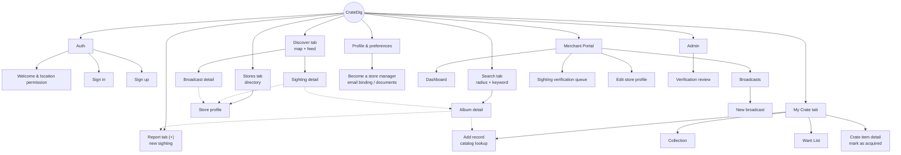

# CrateDig — Site Map

Derived from the [PRD](PRD.md) (Specification #1 plus the §4 Implementation Decisions). The site is a mobile-first PWA built for one-handed portrait use. Collector screens use a bottom tab bar. The Merchant Portal also has to work on desktop browsers at the store counter.

## 1. Roles

| Role | Description | Access |
|---|---|---|
| Guest | Not signed in | Welcome, sign in / sign up, read-only Store Directory |
| Collector | Standard signed-in user (experienced or emerging) | All collector screens |
| Store Manager | Collector who passed merchant verification and is linked to one store | Collector screens plus the Merchant Portal for their store |
| Admin | Reviews document-based merchant applications | Admin console |

> Admin is not in Specification #1. It follows from the decision that document-based merchant applications are reviewed manually.

## 2. Hierarchy

Solid lines show hierarchy. Dotted lines show common cross-links.

## 3. Navigation

- **Collector bottom tabs (5):** Discover · Search · Report (+) · Stores · My Crate. The profile avatar sits in the top bar.
- **Store Managers** get a "Merchant Portal" entry in the top-bar menu. On desktop the portal uses a left sidebar.
- **Admins** get an "Admin" entry in the top-bar menu.
- **Deep links:** a web push for a broadcast opens its Broadcast detail screen. Shared sightings and stores open their detail screens.

## 4. Screen inventory

| Route | Screen | Role | Feature / Story | Key content & actions |
|---|---|---|---|---|
| `/welcome` | Welcome | Guest | 4.2 | Value proposition; request GPS permission; sign in / sign up |
| `/login`, `/signup` | Sign in / Sign up | Guest | 4.1 | Email + password via Supabase Auth |
| `/` | Discover | Collector | 2.4 · US-07, 3.1 · US-08 | Map / Feed toggle; recent non-expired sightings within the default radius; store broadcasts mixed into the feed |
| `/sightings/:id` | Sighting detail | Collector | 2.2, 3.2 | Album, store, timestamp, price note, condition, status (reported / verified / flagged / sold / expired), expiry date (30 days after report) |
| `/broadcasts/:id` | Broadcast detail | Collector | 3.1 · US-08 | Store, message, highlighted records, posted time |
| `/search` | Search | Collector | 2.1 · US-04 | Keyword (album / artist); radius 5 / 10 / 25 in the user's unit (miles default, km preference); genre and pressing filters; list / map results |
| `/albums/:id` | Album detail | Collector | 1.1, 1.2, 2.1 | External-catalog metadata; "In your collection" duplicate warning; nearby sightings; Add to Collection / Want List; Report sighting |
| `/report` | Report sighting | Collector | 2.2 · US-05 | Pick album (catalog search); pick store (nearest first); price note; condition rating; timestamp set automatically |
| `/stores` | Store directory | Guest, Collector | 2.3 · US-06 | Nearby stores sorted by distance; open-now indicator |
| `/stores/:id` | Store profile | Guest, Collector | 2.3, 2.4, 3.1 | Address, hours, phone, policies, map link; recent sightings; recent broadcasts |
| `/crate/collection` | Collection | Collector | 1.1 · US-01 | Owned records with pressing details and condition notes; search and filter; available offline |
| `/crate/wants` | Want List | Collector | 1.2 · US-02 | Wanted albums and target pressings; nearby-sighting badge; available offline |
| `/crate/add` | Add record | Collector | 1.1, 1.2 | External catalog lookup; add to Collection or Want List with pressing and condition notes |
| `/crate/items/:id` | Crate item detail | Collector | 1.3 · US-03 | Edit notes; "Mark as acquired" moves a Want List item to the Collection; remove |
| `/profile` | Profile & preferences | Collector | 4.2 | Display name; distance unit (mi / km); default radius; location permission; push notification opt-in; link to merchant verification |
| `/merchant/verify` | Merchant verification | Collector | 4.1 | Choose store; path A: corporate email on the store's domain plus a confirmation link; path B: upload documents for manual review; application status |
| `/merchant` | Merchant dashboard | Store Manager | 3.x | Store summary; pending sightings count; recent broadcasts |
| `/merchant/broadcasts` | Broadcasts | Store Manager | 3.1 · US-08 | Past broadcasts; create new |
| `/merchant/broadcasts/new` | New broadcast | Store Manager | 3.1 · US-08 | Message and optional highlighted records; publishes to the feed and sends web push to nearby opted-in collectors |
| `/merchant/sightings` | Sighting verification queue | Store Manager | 3.2 · US-09 | Sightings at the manager's store; Confirm / Flag inaccurate / Mark sold |
| `/merchant/store` | Edit store profile | Store Manager | 2.3 | Hours, phone, policies |
| `/admin/verifications` | Verification review | Admin | 4.1 | Queue of document applications; view documents; approve (links manager to store) or reject |

## 5. User story coverage

| Story | Primary screen(s) |
|---|---|
| US-01 Collection cataloging | `/crate/collection`, `/crate/add` |
| US-02 Want List | `/crate/wants`, `/crate/add` |
| US-03 Want → Collection transfer | `/crate/items/:id` |
| US-04 Radius & keyword search | `/search` |
| US-05 Report sighting | `/report` |
| US-06 Store directory | `/stores`, `/stores/:id` |
| US-07 Map & visual feed | `/` |
| US-08 Stock arrival broadcasts | `/merchant/broadcasts/new`, `/`, `/broadcasts/:id` |
| US-09 Sighting verification | `/merchant/sightings` |

## 6. Offline behaviour

Per PRD §1.3, record shops often have poor coverage. These screens are cached so they still work inside a store:

- **Readable offline:** My Crate (Collection, Want List), recently viewed store profiles.
- **Queued offline:** new sightings and crate edits are saved locally and synced when the connection returns (optimistic UI).
- **Online only:** Search, Discover map, Merchant Portal, and verification.
