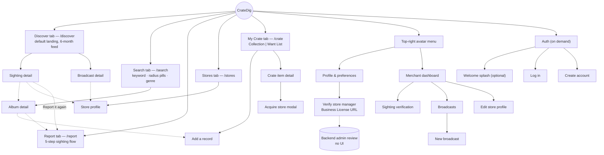

# CrateDig — Site Map

Derived from the [PRD](PRD.md) (Specification #3, §4 Skeleton Layer). The app is a mobile-first PWA built for one-handed portrait use in dimly lit shops. It has a persistent 5-tab bottom bar, a top-right avatar menu and a dark navy (`#0F172A`) / burnt orange (`#F97316`) theme. Merchant screens also have to work on a desktop browser at the store counter.

## 1. Roles

| Role | Description | Access |
|---|---|---|
| Guest | Not signed in | Read-only: Discover, Search, Sighting/Broadcast/Album details, Store Directory and Store Profiles |
| Collector | Registered user (`collector`) | Everything a guest sees, plus Report, My Crate, Profile, and the store manager application |
| Store Manager | Collector whose store claim was verified (`store_manager`), linked to one store | Collector access plus the Merchant Dashboard for their store |
| Admin | Internal operator (`admin`) | **No UI.** Reviews Business License URLs and sets `stores.verification_status` directly in the database |

A guest who taps a protected action (Report, My Crate, Save/Add, "Log in to add or report") is sent to `/login`, which links to `/signup`. After signing in they return to the action they started.

## 2. Hierarchy

Solid lines show hierarchy. Dotted lines show common cross-links.

## 3. Navigation

- **Entry:** opening the app (or `/`) goes to `/discover` for everyone. `/welcome` is an optional splash with Create account, Log in and "keep digging as a guest".
- **Bottom tabs (always visible):** Discover · Search · Report · Stores · My Crate. Report is the centre tab.
- **Top-right avatar:** a circle with the user's initials. It opens Profile & Preferences, and also the Merchant Dashboard for verified managers. Guests see a Log in button in this spot instead.
- **Sign out** (in `/profile`) clears the session and returns to guest mode on `/discover`.
- **Deep links:** a broadcast push opens `/broadcasts/:id`. Shared sightings, albums and stores open their detail screens.

## 4. Screen inventory

Story IDs follow PRD §2.2 (US-01 – US-10).

| Route | Screen | Role | Feature / Story | Key content & actions |
|---|---|---|---|---|
| `/discover` | Discover feed | Guest+ | 2.4 · US-01 | Default landing; 6-month rolling feed of active sightings and store broadcasts within the default radius (GPS or ZIP); prices in USD, distances in mi |
| `/welcome` | Welcome splash | Guest | 4.1 · US-01 | Branding; Create account; Log in; "keep digging as a guest" |
| `/login` | Log in | Guest | 4.1 · US-01 | Email, password, full-width Log in button, Create an account link, inline errors |
| `/signup` | Create account | Guest | 4.1 · US-01 | Display name, email, optional 5-digit U.S. ZIP fallback (e.g. 97205), password + confirmation |
| `/search` | Search sightings | Guest+ | 2.1 · US-05 | Keyword; radius pills 5 / 10 / 25 mi; All genres dropdown; sighting cards with initial badge, USD price, distance |
| `/sightings/:id` | Sighting details | Guest+ | 2.1, 2.2, 3.2 · US-05, US-06, US-09 | Album badge; store and distance; reporter; USD price; condition grade; special attributes; status pill; "Verified by store" mark; archive date; **Report it again** |
| `/broadcasts/:id` | Store broadcast | Guest+ | 3.1 · US-08 | Store header and distance; arrival summary; optional photo link; featured album cards; Visit store profile |
| `/stores` | Record stores | Guest+ | 2.3 · US-07 | Distance pills (within 5 / 10 / 25 mi); store cards with letter icon, distance, U.S. address, green verified check |
| `/stores/:id` | Store profile | Guest+ | 2.3 · US-07 | Address and Open in Maps; phone link; website; Mon–Sun hours; payment methods; specialty tags; active sightings; broadcasts; favorite toggle (collectors) |
| `/albums/:id` | Album details | Guest+ | 1.1, 1.2, 2.1 · US-02, US-03, US-05 | Badge or cover; artist/composer; year; label; key track; genre; catalog ID; crate buttons (or a login prompt for guests); nearby active sightings |
| `/report` | Report a sighting | Collector | 2.2 · US-06 | Step 1 catalog lookup (≥ 2 chars) → 2 store (GPS pre-selected, dropdown override) → 3 condition → 4 optional USD price → 5 optional special attributes |
| `/crate` | My Crate | Collector | 1.1, 1.2 · US-02, US-03 | Collection / Want List toggle; keyword search; All genres filter; + Add record; item cards with USD price |
| `/crate/add` | Add a record | Collector | 1.1, 1.2 · US-02, US-03 | Catalog lookup; destination (Collection / Want List); optional condition, special attributes, price paid, notes |
| `/crate/items/:id` | Crate item detail + **Acquire store modal** | Collector | 1.3 · US-04 | Edit notes; on Want List items, **Mark as acquired** opens a modal listing stores with active sightings of the record, plus "Acquired elsewhere" |
| `/profile` | Profile & preferences | Collector | 4.2 · US-10 | Display name; ZIP fallback; default radius (10 mi); distance unit (mi default); genre typing pills; favorite stores; broadcast push toggle; Become a store manager; Sign out |
| `/merchant/verify` | Verify store manager | Collector | 4.3 | Store dropdown; Business License URL (`https://…`); status Pending / Verified / Rejected |
| `/merchant` | Merchant dashboard | Store Manager | 3.1, 3.2 · US-08, US-09 | Verified badge; pending sightings card (Review); recent broadcasts card (+ New broadcast); Edit store profile |
| `/merchant/sightings` | Sighting verification | Store Manager | 3.2 · US-09 | Queue of sightings at the manager's store; ✓ Confirm, Flag, Mark sold (history kept) |
| `/merchant/broadcasts` | Broadcast history | Store Manager | 3.1 · US-08 | Past broadcasts; + New broadcast |
| `/merchant/broadcasts/new` | New broadcast | Store Manager | 3.1 · US-08 | Arrival summary (≤ 500 chars); optional photo URL; up to 10 featured records; Preview → Publish |
| `/merchant/store` | Edit store profile | Store Manager | 2.3 · US-07 | Mon–Sun hours; U.S. phone; website; payment-method and specialty-tag typing pills |
| _(none)_ | Admin license review | Admin | 4.3 | Backend database only; there is deliberately no frontend screen |

## 5. User story coverage

| Story | Primary screen(s) |
|---|---|
| US-01 Guest-first Discover | `/discover`, `/login`, `/signup`, `/welcome` |
| US-02 Collection cataloging | `/crate` (Collection), `/crate/add`, `/albums/:id` |
| US-03 Want List tracking | `/crate` (Want List), `/crate/add`, `/albums/:id` |
| US-04 Acquire & store sync | `/crate/items/:id` + acquire modal |
| US-05 Radius & keyword search | `/search`, `/sightings/:id` |
| US-06 Sighting reporting | `/report` |
| US-07 Store directory | `/stores`, `/stores/:id`, `/merchant/store` |
| US-08 Stock arrival broadcasts | `/merchant/broadcasts/new`, `/broadcasts/:id`, `/discover` |
| US-09 Sighting verification | `/merchant/sightings`, `/merchant` |
| US-10 Profile & preferences | `/profile` |

## 6. Offline behaviour

Per PRD §1.3, record shops often have poor coverage and bandwidth needs to stay low. Records show two-letter badges unless a cover URL exists, and nothing is uploaded.

- **Readable offline:** My Crate (Collection, Want List) and recently viewed store profiles.
- **Queued offline:** new sightings and crate edits are saved locally and synced when the connection returns.
- **Online only:** Search, the Discover feed refresh, the Merchant Dashboard and store-manager verification.
